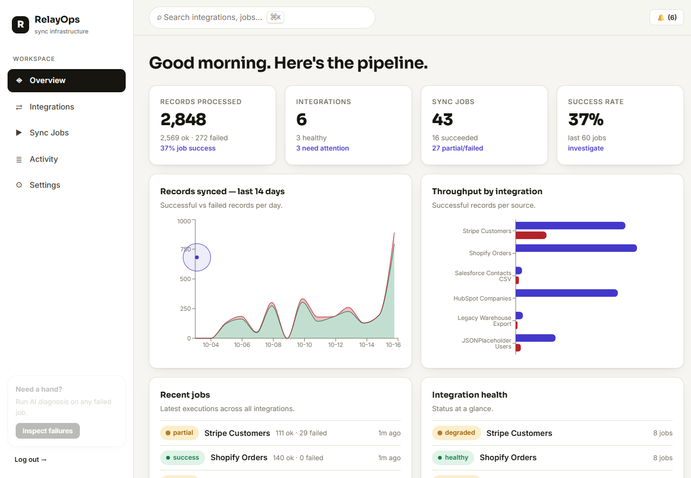
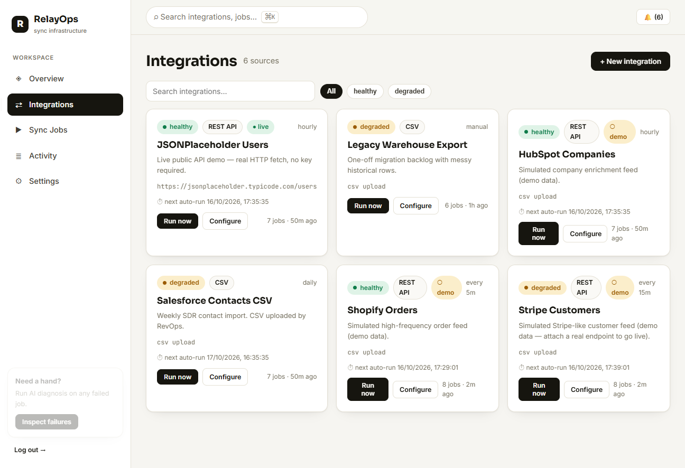
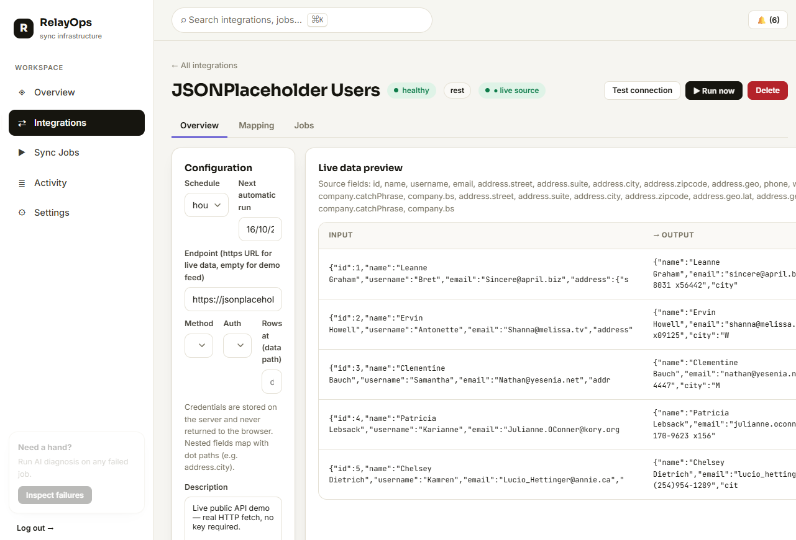
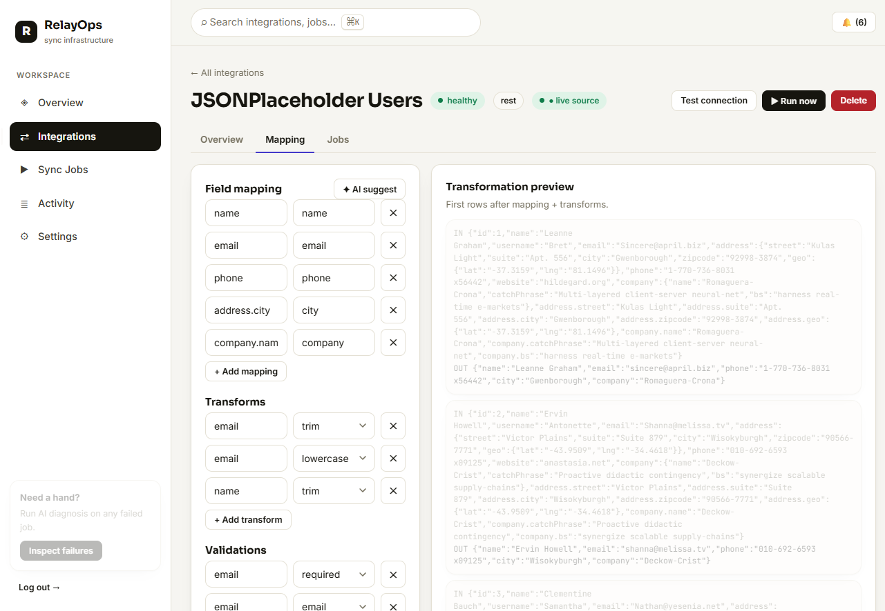
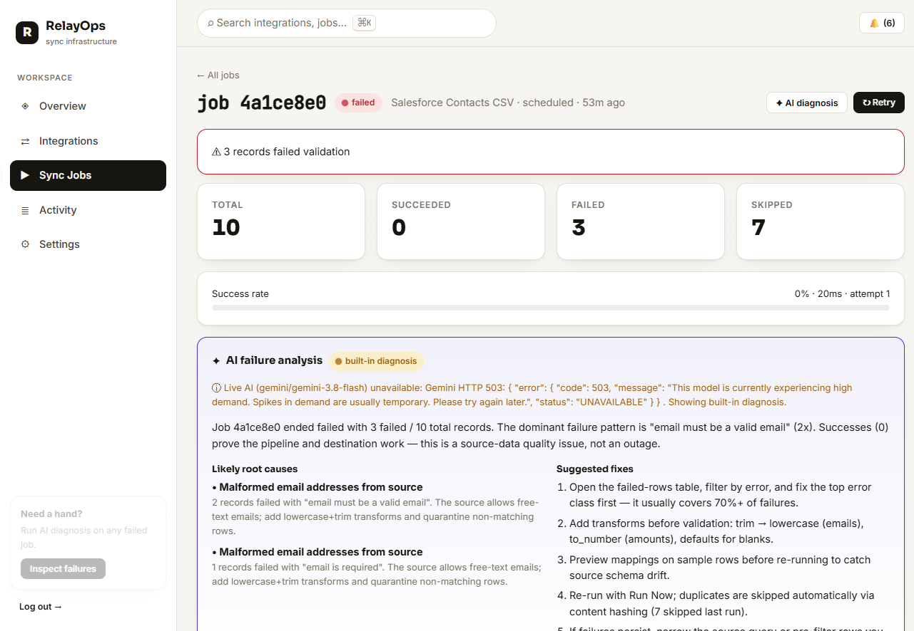
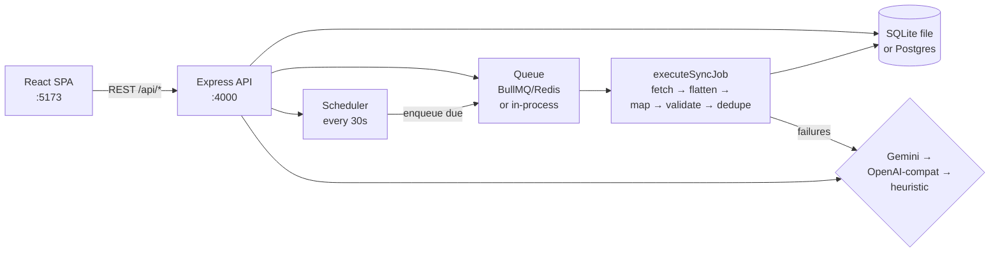

<div align="center">

# RelayOps

**Connect any REST API or CSV. Map it, validate it, sync it — and understand every failure.**

[](./frontend)
[](https://www.typescriptlang.org/)
[](./backend)
[](#database)
[](#background-jobs--scheduling)
[](#ai-configuration)
[](#with-docker)

</div>

RelayOps is a complete, self-hostable **API integration and data synchronization platform**. Point it at any HTTPS JSON endpoint (or paste a CSV), configure field mappings, transforms, and validation rules, and it syncs records through a real background pipeline — with per-record results, execution logs, automatic scheduling, duplicate prevention, and **AI-powered failure diagnosis**.



## Why RelayOps

- **Real ingestion, not mocks** — live HTTP fetching with auth (Bearer / API key / Basic), JSON validation, dot-path row extraction (`data.items`), and nested-field mapping (`address.city`).
- **A pipeline you can inspect** — every run persists per-record inputs, outputs, errors, logs, and stats. Nothing is a black box.
- **Schedules that just run** — set `every_5m` … `daily` and the scheduler fires jobs automatically, with overlap protection and visible next-run times.
- **Failures that explain themselves** — Gemini (free tier) analyzes failed jobs into root causes + fixes, with a built-in engine when AI is unavailable.
- **Zero-config local start** — SQLite + in-process queue out of the box; Postgres + BullMQ/Redis when you set two URLs.

## Feature gallery

| Integrations — live vs demo at a glance | Configuration + live data preview |
|---|---|
|  |  |

| Visual mapping editor + AI suggestions | Job execution + AI failure diagnosis |
|---|---|
|  |  |

## Features

- REST integrations with method, auth, data-path, and connection testing
- CSV ingestion with server-side payload persistence
- Field mapping (incl. nested dot-paths), 7 transforms, 7 validation rules
- Live transformation preview before running
- Background execution (BullMQ/Redis or in-process) + 30s auto-scheduler
- SHA-1 content-hash deduplication, retries (max 3 attempts)
- Record-level results with error filtering, timestamped execution logs
- 14-day analytics, integration health, activity feed, notifications, ⌘K search
- Gemini failure diagnosis + AI mapping suggestions, graceful heuristic fallback
- JWT auth, masked credential storage, light-only polished UI, responsive + mobile nav

## Architecture



A sync run: **fetch** (live HTTP, CSV, or demo feed) → **flatten** nested keys → **apply mappings + transforms** → **validate** → **dedupe** by content hash → persist records, logs, and stats → update health, activity, and notifications.

## Tech stack

| Layer | Technologies |
|---|---|
| Frontend | React 18, TypeScript, Vite, React Router, Recharts, hand-rolled CSS design system |
| Backend | Node.js 20+, Express 4, Zod, JWT + bcryptjs |
| Database | SQLite (Node built-in, zero-config) or PostgreSQL via `DATABASE_URL` |
| Jobs | BullMQ + Redis via `REDIS_URL`, else in-process runner + internal scheduler |
| AI | Google Gemini (`gemini-3.8-flash`, free tier) or OpenAI-compatible endpoint |
| Deploy | Docker Compose (postgres, redis, api, nginx) · Vercel (web) + Render/Railway/Fly (api) |

## Getting started

**One click (Windows):** double-click **`start-relayops.bat`** — it installs, builds, and opens both servers. Then open http://localhost:5173 and sign in with `admin@relayops.io` / `password123`.

**Manual:**

```bash
# install everything (Node 20+ required)
npm run install:all

# terminal 1 — API (http://localhost:4000)
npm run dev:api
# first run only: seed demo account + sample data
npm run seed

# terminal 2 — web app (http://localhost:5173)
npm run dev:web
```

Root conveniences: `npm run build`, `npm test`, `npm run typecheck` (all delegate to the workspaces).

### With Docker

```bash
docker compose up --build
# web → http://localhost:5173 · api → http://localhost:4000
```

## Environment configuration

Copy `.env.example` → backend `.env` (gitignored) and fill in what you need. Everything is optional except a production `JWT_SECRET`:

| Variable | Purpose | Default |
|---|---|---|
| `PORT` | API port | `4000` |
| `JWT_SECRET` | token signing (**change in production** — the server refuses to boot with the default when `NODE_ENV=production`) | dev placeholder |
| `DATABASE_URL` | Postgres connection string | unset → local SQLite file |
| `REDIS_URL` | BullMQ backend | unset → in-process runner |
| `AI_PROVIDER` | `gemini` / `openai` / unset | unset → heuristic fallback |
| `GOOGLE_API_KEY` | Gemini key from [Google AI Studio](https://aistudio.google.com/) (free tier) | unset |
| `AI_MODEL` | model identifier | `gemini-3.8-flash` |
| `AI_API_KEY`, `AI_BASE_URL` | OpenAI-compatible endpoint (e.g. OpenRouter) | unset |
| `FRONTEND_URL` | CORS origin | `http://localhost:5173` |
| `VITE_API_URL` | frontend → API base (set to deployed API on Vercel) | same-origin |
| `SEED_DEMO` | `true` allows demo account + sample data when seeding production | unset (demo seed skipped in production) |

### AI configuration

1. Create a free key at Google AI Studio.
2. Set `AI_PROVIDER=gemini` + `GOOGLE_API_KEY=<key>` in the backend environment, restart the API.
3. Settings → Environment should read `AI: live (gemini/gemini-3.8-flash)`.
4. Open any failed job → **✦ AI diagnosis**; mapping editor → **✦ AI suggest**.
5. Without a key (or on provider errors/rate limits) the built-in engine answers instead, and the UI says so. Keys live only in backend env — never in the frontend bundle or responses.

## Database

Schema (`backend/migrations/001_init.sql`) auto-applies on boot, including additive `ALTER TABLE`s for existing databases. Tables: `users, integrations, jobs, job_records, job_logs, activity, notifications, processed_hashes`. Integration credentials (`auth_secret`) are stored server-side and never serialized — APIs expose only `has_secret` plus a masked hint.

## Testing

```bash
npm test            # backend vitest suite (19 tests)
npm run typecheck   # tsc --noEmit, both workspaces
npm run build       # production builds, both workspaces
```

Covered: CSV parsing, transforms, validations (incl. uniqueness), dedupe counting, HTTP helpers (extraction, dot-paths, auth headers, masking), scheduler math, mapping heuristics — plus live end-to-end runs (auth, CRUD, real fetch, scheduling, retries, AI fallback) verified against the running app.

## Project structure

```
relayops/
  backend/          Express API (src/: routes, engine, queue, scheduler, ai, http, db)
  frontend/         React SPA (src/: pages, components, api client, design system)
  docs/screenshots/ README gallery (real product captures)
  docker-compose.yml  postgres + redis + api + web
  render.yaml         Render blueprint (api + postgres + redis)
  start-relayops.bat  one-click Windows launcher
  .env.example        safe placeholder config
```

## Deployment

- **Frontend → Vercel:** import `frontend/`, framework preset Vite, `vercel.json` handles SPA rewrites; set `VITE_API_URL=https://<your-api>`.
- **Backend → Render/Railway/Fly:** Node 20+, build `npm install && npm run build`, start `node dist/index.js`; attach managed Postgres (`DATABASE_URL`) and Redis (`REDIS_URL`); set `JWT_SECRET`, `FRONTEND_URL=https://<your-vercel-app>`, `AI_PROVIDER` + `GOOGLE_API_KEY`. `render.yaml` encodes the Render setup (free tiers suffice for demo traffic).
- **Notes:** schema migrates itself on boot; the in-process scheduler runs on a single instance (fine for one Render instance — use Redis + BullMQ if you scale out); never run the demo seed password publicly — create a real account and rotate `JWT_SECRET`; CORS is restricted to `FRONTEND_URL`.

## Roadmap

- Cron-expression schedules + per-integration concurrency limits
- Webhook triggers and incremental (cursor-based) syncs
- Per-record retry / quarantine-and-replay for failed rows
- Postgres-backed BullMQ as the default when `REDIS_URL` is present
- Team workspaces and role-based access

---

Built as an end-to-end full-stack project: React + TypeScript + Express + Postgres/SQLite + BullMQ + Gemini.
